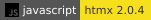
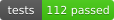
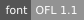

# Агрегатор ИТ-вакансий с профилем ФСП

[](product/pyproject.toml)
[](product/app/static/htmx.min.js)
[](product/app/templates)
[](product/app/static/brand.css)
[](product/app/db)
[](deploy/fsp/entrypoint.sh)
[](product/pyproject.toml)
[](deploy/fsp/compose.yaml)
[](deploy/fsp/compose.yaml)
[](product/static/fonts/OFL.txt)

Спецтрек ЛЦТ, Федерация спортивного программирования.

Авторы: Чистяков Евгений, Иван Курлыков, Леонид Пластуненко, Николай Кузнецов, Игорь Софронов.

Прототип: кабинеты соискателя и работодателя, категория из специализации и грейда, тест грейда (свой вариант из 12 вопросов, ключ только на сервере, итог с уверенностью — см. [`product/validation_sim`](product/validation_sim/README.md)), разбор текстового PDF, поиск по всей базе, приглашение с вилкой в рублях до вычета НДФЛ и контактом компании. Вакансия работодателя публикуется с той же вилкой; отклик и короткое задание на его форме — не то задание, которое кандидат видит не чаще раза в 30 дней. Боевого реестра ФСП на стенде нет.

## Быстрый старт

На машине заранее стоят только Docker Engine и плагин Compose. Язык, пакеты и база на хост не ставятся. База Python лежит в репозитории, Docker Hub для сборки не нужен. Полный `up` поднимает кабинеты и локальный issuer реалма `fsp` на порту 8080. Образ Keycloak не скачивается: при распаковке его слоя на диске кончается место, и установка обрывается. Почта остаётся входом, связь ID — кнопка в кабинете. Переключение на issuer заказчика — [`deploy/fsp/keycloak.md`](deploy/fsp/keycloak.md). Копировать `compose.env` не нужно: если `PRODUCT_SECRET` короче 32 символов, точка входа пишет секрет в том `/data/product_secret`.

```text
docker compose -f deploy/fsp/compose.yaml up --build
```

| Что | Адрес |
| --- | --- |
| Кабинеты | <http://127.0.0.1:8000> |
| Локальный реалм | <http://127.0.0.1:8080> |
| OpenAPI, без сети | <http://127.0.0.1:8000/docs> |
| ReDoc, без сети | <http://127.0.0.1:8000/redoc> |

```text
docker compose -f deploy/fsp/compose.yaml --profile test run --rm tests
```

Бейдж «tests» в шапке пишет этот прогон: зелёный, если все тесты прошли.

Подробности — в [`product/README.md`](product/README.md).
