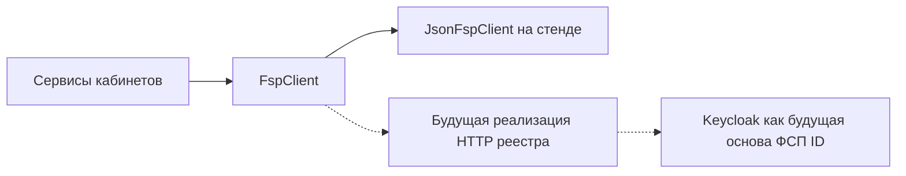

# Сопроводительная записка

Авторы: Чистяков Евгений, Иван Курлыков, Леонид Пластуненко, Николай Кузнецов, Игорь Софронов.

Прототип агрегатора ИТ-вакансий с профилем достижений Федерации спортивного программирования. Стенд — один процесс. Боевого реестра на нём нет.

## Архитектура

Монолит Python 3.12 в каталоге `product`. Три слоя живут в одном процессе uvicorn с одним worker:

- Веб: Jinja2 и локальный htmx. Страницы `/auth`, `/candidate`, `/employer`. Файл htmx лежит в репозитории, ссылок на CDN нет. В светлой шапке знак `logo_02w.svg`.
- API: FastAPI, префикс JSON `/api`. Сессия — cookie `product_session`.
- Хранилище: один файл SQLite в режиме WAL. На стенде это `/data/app.sqlite` в томе `fsp-sqlite`. Писатель один.

Подбор, тест и разбор резюме — функции в `product/matching`. Мок достижений при старте кладёт JSON из git в SQLite; кабинеты и пересчёт категории читают одни таблицы. Каталог `memory` продукт не импортирует. Отдельной СУБД, React и Keycloak в compose нет.

## Механика теста

Испытание не расползается одним общим заданием. На пару «специализация и грейд» приходится два или три своих шаблона. Какой открыть, решает `select_template` по `profile_id` и `rule_version`. На проходе текст шаблона не меняется. Те же ответы на том же шаблоне дают тот же грейд.

Итог подтверждает заявленный грейд или предлагает соседний. Балл ниже порога подтверждения грейд не понижает. Соседний грейд сдаётся отдельной попыткой и только если последняя попытка записанной пары предложила именно этот шаг. Повтор ограничен интервалом из правил: на стенде это 90 дней. Записанный грейд меняет лишь соседняя попытка с итогом `confirm`. Кнопки «принять грейд» нет.

Специализаций шесть, грейдов четыре. Вопросы и границы балла лежат в шаблоне конкретной пары. Поэтому один общий набор не отличает, например, junior backend от lead security.

Несколько описаний вакансий только показывают выбранный шаблон. Текст вакансии в вопросы не разбирается.

## Подбор и категоризация

Категория — специализация и записанный грейд, например `backend:middle`. Отрасль MVP только `it`: она видна в статусе профиля и в `category_id` не входит. Версия правил — `v1`. Рядом хранится короткое объяснение, почему категория такая.

Ранг внутри категории: сначала балл теста, затем число подтверждённых достижений ФСП, затем номер профиля. Подходящих не скрываем. В выдаче работодателя только опубликованный профиль со сданным тестом. Фильтр добавляет стек, роль, формат и признак достижений. Резюме пишет узнанные поля с пометкой `source=resume` и пересчитывает категорию тем же правилом, что и анкета. После записанного итога теста PDF грейд не меняет. Разряд ФСП хранится строкой источника и в категорию не переводится.

Приглашение работодатель отправляет сам из этой выдачи: текст, название компании, способ связи компании и вилка в рублях. Нужны обе границы, верхняя строго больше нижней, валюта RUB. Способ связи компании соискатель видит сразу. Почта соискателя появляется у работодателя отдельным полем только после `accepted`. Открытие приглашения переводит `sent` в `seen`. Чужие доски не разбираются.

## Валидация

Прогон читает золотой набор из git и в сеть не ходит. Ожидаемые категорию, итог теста и отметку релевантности разметил человек. Функции категории и прогона эти поля не заполняют. На стенде это одно действие: ссылка «Прогон валидации», `GET /validation`, ответ `text/plain`. Порога, ниже которого прогон считается проваленным по проценту, нет.

Ниже строки запуска со стенда 2026-10-05, контейнер `fsp-vacancies-app-1`, после входа работодателя. Второе чтение той же ссылки вернуло тот же текст. Это числа этого запуска, не цель.

```text
category_match 38 38
outcome_match 32 32
template_stable 4 4
relevant_in_top 23 24
resume_ok 4 4
```

Первое число строки — сколько совпало или оказалось в топе, второе — сколько элементов было в запуске.

## Будущая интеграция с реестром ФСП

Кабинеты зависят от интерфейса `FspClient`. На стенде это чтение `participants.json`. Позже та же точка может получить HTTP-реализацию реестра. Вход в реестр по этой схеме опирается на Keycloak как будущую основу ФСП ID. На стенде Keycloak не поднимается, пунктир не настроен, секрета боевой ФСП нет. Связь анкеты с участником — необязательный `external_id`.



## API

Методы, тела, ответы и примеры ошибок лежат в `product/openapi.json`. На стенде те же страницы открываются в `/docs` и `/redoc` без интернета: статика Swagger UI 5.33.1 и ReDoc 2.5.4 лежит в репозитории. Схема безопасности — cookie `product_session`. Без входа закрытый метод отвечает 401. Без сессии доступны регистрация, подтверждение кода, повтор кода и вход.

Группы маршрутов: `/api/auth`, профиль и достижения соискателя, тест, резюме и PDF профиля, категория и выдача работодателя, карточка компании, приглашения, `GET /validation`.

## Библиотеки

Список снят `pip freeze` внутри образа `fsp-vacancies:local` на Python 3.12 и записан в `product/requirements.lock`. Строка `fsp-vacancies @ file:///srv/product` — так pip называет пакет, поставленный из дерева образа. Версия пакета в `product/pyproject.toml` — 0.1.0.

Прямые зависимости образа:

| Пакет | Версия |
| --- | --- |
| fastapi | 0.142.2 |
| uvicorn | 0.54.0 |
| SQLAlchemy | 2.1.3 |
| Jinja2 | 3.1.6 |
| python-multipart | 0.0.32 |
| argon2-cffi | 25.1.0 |
| itsdangerous | 2.2.0 |
| pypdf | 6.19.0 |
| reportlab | 5.0.1 |
| pytest | 8.4.2 |
| httpx | 0.28.1 |

pytest и httpx нужны прогону тестов в том же образе, не отдельному хостовому окружению. Транзитивные пакеты — в lock-файле, среди них starlette 1.7.0, pydantic 2.13.5, pillow 12.3.0.

Рядом, не как пакеты Python: htmx (Zero-Clause BSD, локальный файл), Swagger UI 5.33.1 (Apache-2.0), ReDoc 2.5.4 (MIT), шрифт JetBrains Mono (SIL Open Font License 1.1).

## Сборка и запуск

На хосте заранее стоят только Docker Engine и плагин Compose. Язык, пакеты и база продукта на хост не ставятся. Копировать `compose.env` не нужно: если `PRODUCT_SECRET` короче 32 символов, точка входа пишет секрет в том `/data/product_secret`. Свой секрет можно положить в `deploy/fsp/compose.env` по образцу `compose.env.example`; файл в git не входит.

```text
docker compose -f deploy/fsp/compose.yaml up --build
```

Образ собирается из `python:3.12-slim`. Зависимости ставит `pip` внутри Dockerfile. Точка входа при необходимости пишет секрет, выполняет `python -m product.seed`, затем uvicorn на порту 8000. Клиент, API и файл базы — этот процесс и том. Keycloak, Pango и Node в образ не входят. Кабинеты: `http://127.0.0.1:8000`.

Проверка тестов:

```text
docker compose -f deploy/fsp/compose.yaml --profile test run --rm tests
```

Прогон валидации второй командой не запускается. Его нажимают на стенде после четырёх шагов из `track/lct-fsp-vacancies/demo.md`.

## Модерация и ATS

На стенде нет модерации вакансий и нет коннектора к чужой ATS. Прототип не читает внешние доски и не показывает ленту чужих вакансий: работодатель сам пишет приглашение человеку из категории, который уже сдал тест. Проверка юрлица и корпоративной почты на MVP не требуется, бейджа реестра нет. Выгрузка в Huntflow или другую ATS была бы отдельным коннектором к чужой системе. Его нет. Защита от фиктивных вакансий поэтому не отдельный сервис, а граница скоупа: без своей доски и без приёма внешней ссылки модерировать нечего.

## Что сознательно не вошло

Публичный адрес стенда здесь не указан: его нет в репозитории. Свои вакансии, отклик, короткое задание работодателя и адаптив под телефон обязательный путь не закрывают и этот стенд не блокируют.
