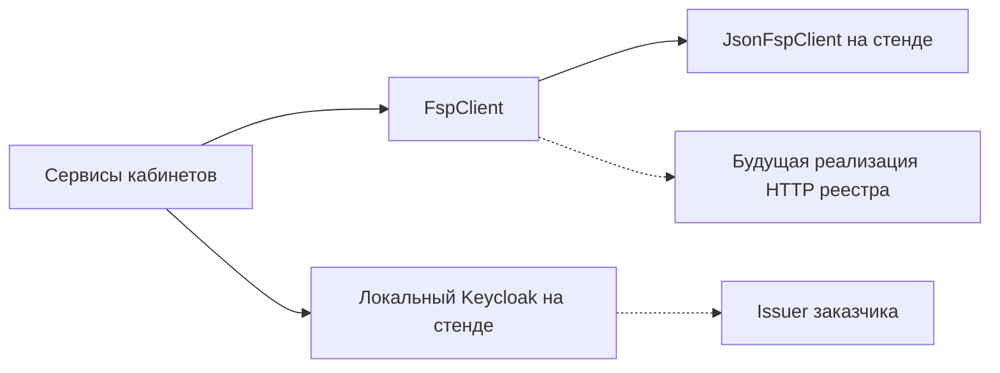

# Сопроводительная записка

Авторы: Чистяков Евгений, Иван Курлыков, Леонид Пластуненко, Николай Кузнецов, Игорь Софронов.

Прототип агрегатора ИТ-вакансий с профилем достижений Федерации спортивного программирования. Стенд — один процесс. Боевого реестра на нём нет.

## Архитектура

Монолит Python 3.12 в каталоге `product`. Три слоя живут в одном процессе uvicorn с одним worker:

- Веб: Jinja2 и локальный htmx. Страницы `/auth`, `/candidate`, `/employer`. Файл htmx лежит в репозитории, ссылок на CDN нет. В светлой шапке знак `logo_02w.svg`.
- API: FastAPI, префикс JSON `/api`. Сессия — cookie `product_session`.
- Хранилище: один файл SQLite в режиме WAL. На стенде это `/data/app.sqlite` в томе `fsp-sqlite`. Писатель один.

Подбор, тест и разбор резюме — функции в `product/matching`. Мок достижений при старте кладёт JSON из git в SQLite; кабинеты и пересчёт категории читают одни таблицы. Каталог `memory` продукт не импортирует. Отдельной СУБД и React в compose нет. Локальный Keycloak есть и в образ приложения не входит.

### Модели

В обязательном пути жюри моделей нет: категоризация, тест, подбор, разбор PDF и приглашение считаются правилами в `product/matching` и сервисами кабинетов. Разбор резюме — `pypdf` 6.19.0 и локальный словарь `stack_synonyms.json`, без внешнего вызова. Локального инференса нет, GPU на стенде нет и не требуется. Персональные данные (почта, ФИО, анкета) живут в SQLite тома стенда и за контур процесса не уходят. Если позже появится генерация заданий — только российская модель, вне обязательного пути жюри, с отдельным описанием в записке. Перечень допустимых моделей организаторы обещали отдельно, в записку его не подставляем.

## Механика теста

Испытание не расползается одним общим заданием. Каталог собирается из стемов: на пару «специализация и грейд» приходится три своих шаблона с уникальными формулировками. Какой открыть, решает `select_template` по `profile_id` и `rule_version`. На проходе текст не меняется. Те же ответы на том же шаблоне дают тот же грейд. Отдельных JSON на пару нет. Четвёртого шаблона нет.

Итог подтверждает заявленный грейд или предлагает соседний. Балл ниже порога подтверждения грейд не понижает. Соседний грейд сдаётся отдельной попыткой и только если последняя попытка записанной пары предложила именно этот шаг. Повтор ограничен интервалом из правил: на стенде это 90 дней. Интервал держится на шаге вверх и на повторной смене, когда тест уже один раз записал новый грейд. Первая попытка предложенного ниже грейда после `suggest_lower` интервал не ждёт, пока соседний `confirm` не сдвинул записанный грейд. Повтор теста записанного грейда интервал не ждёт. Признак смены — реплей сданных `test_attempts` по `id`, не равенство штампов и не расхождение с анкетой: PDF грейд пишет без флага теста. Сто баллов на грейде ниже (`suggest_higher`) грейд не пишет и интервал не тратит. Записанный грейд меняет лишь соседняя попытка с итогом `confirm`. Кнопки «принять грейд» нет.

Специализаций шесть, грейдов четыре. На пару — три шаблона, буквы a, b и c: 72 шаблона и 216 вопросов, буква c есть на каждой паре. В шаблоне три вопроса, ключи q1=b, q2=c, q3=a, пороги `confirm_min` 50 и `suggest_higher_min` 80. Идентификаторы и ключ ответа на проходе не меняются. Один общий набор не отличает, например, junior backend от lead security.

Несколько описаний вакансий только показывают выбранный шаблон. Текст вакансии в вопросы не разбирается.

## Подбор и категоризация

Категория — специализация и записанный грейд, например `backend:middle`. Отрасль MVP только `it`: она видна в статусе профиля и в `category_id` не входит. Версия правил — `v1`. Рядом хранится короткое объяснение, почему категория такая.

Ранг внутри категории — один проход `evaluate_need`: кортеж совпадений (стек, роль, формат, признак ФСП, токены текста) и затем `rank_key` `confirmed-score-count-prize-id`. Отдельных баллов за фильтры нет. Пустая потребность оставляет нули в кортеже и прежний порядок. Подходящих не скрываем. В выдаче работодателя опубликованный профиль совпавшей категории; без теста карточка со статусом «не подтверждён» и ниже сдавших той же категории через префикс `rank_key`; без `publication` карточки нет. Фильтр добавляет стек, роль, формат и признак достижений. На карточке фраза из того же прохода, почему этот человек попал в потребность. Резюме пишет узнанные поля с пометкой `source=resume` и пересчитывает категорию тем же правилом, что и анкета. После записанного итога теста PDF грейд не меняет. Разряд ФСП хранится строкой источника и в категорию не переводится.

Приглашение работодатель отправляет с карточки подборки: номер профиля и категория подставляются скрытыми полями. В форме — текст, название компании, способ связи компании и вилка в рублях до вычета НДФЛ. Нужны обе границы, верхняя строго больше нижней, валюта RUB. Способ связи компании соискатель видит сразу. Почта соискателя появляется у работодателя отдельным полем только после `accepted`. Открытие приглашения переводит `sent` в `seen`. Чужие доски не разбираются.

## Валидация

Прогон читает золотой набор из git и в сеть не ходит. Ожидаемые категорию, итог теста и отметку релевантности разметил человек. Функции категории и прогона эти поля не заполняют. На стенде это одно действие: ссылка «Прогон валидации», `GET /validation`, ответ `text/plain`. Порога, ниже которого прогон считается проваленным по проценту, нет.

Ниже строки запуска со стенда 2026-10-06. Команда `docker compose -f deploy/fsp/compose.yaml --profile test run --rm --build tests` завершилась `43 passed`. В том же образе `python -m product.matching.golden_run` напечатал пять строк. `GET /validation` после входа работодателя отдаёт тот же текст. Повтор прогона не изменил строки. Набор в git: 38 синтетических профилей, 12 потребностей (`top_k=3`), 4 пары «тот же шаблон — те же ответы», 4 PDF резюме. Это числа этого запуска, не цель.

```text
category_match 38 38
outcome_match 32 32
template_stable 4 4
relevant_in_top 23 24
resume_ok 4 4
```

Первое число строки — сколько совпало или оказалось в топе, второе — сколько элементов было в запуске. Смысл строк:

- `category_match` — сколько профилей получили ожидаемую категорию;
- `outcome_match` — сколько итогов теста совпали с разметкой;
- `template_stable` — сколько повторов того же шаблона и тех же ответов дали тот же грейд;
- `relevant_in_top` — сколько отмеченных релевантными попали в топ слотов этого запуска;
- `resume_ok` — сколько PDF разобрались без падения процесса.

## Будущая интеграция с реестром ФСП

Кабинеты зависят от интерфейса `FspClient`. На стенде это чтение `participants.json`. Боевого коннектора реестра нет. Стенд поднимает локальный реалм Keycloak. Кандидат, уже вошедший по почте, связывает `external_id` из claim `fsp_external_id` или `sub`. Секрета боевой ФСП нет. На схеме локальный Keycloak — сплошной узел стенда, issuer заказчика — пунктир.



## API

Методы, тела, ответы и примеры ошибок лежат в `product/openapi.json`. На стенде те же страницы открываются в `/docs` и `/redoc` без интернета: статика Swagger UI 5.33.1 и ReDoc 2.5.4 лежит в репозитории. Схема безопасности — cookie `product_session`. Без входа закрытый метод отвечает 401. Без сессии доступны регистрация, подтверждение кода, повтор кода и вход.

Группы маршрутов: `/api/auth`, профиль и достижения соискателя, тест, резюме и PDF профиля, категория и выдача работодателя, карточка компании, приглашения, вакансии и отклик (`/api/vacancies`, отклик, одно короткое задание), `GET /validation`.

## Библиотеки

Список снят `pip freeze` внутри образа `fsp-vacancies:local` на Python 3.12 и записан в `product/requirements.lock`. Строка `fsp-vacancies @ file:///srv/product` — так pip называет пакет, поставленный из дерева образа. Версия пакета в `product/pyproject.toml` — 1.2.1.

Прямые зависимости образа:

| Пакет | Версия |
| --- | --- |
| fastapi | 0.142.2 |
| uvicorn | 0.54.0 |
| SQLAlchemy | 2.1.3 |
| Jinja2 | 3.1.6 |
| python-multipart | 0.0.32 |
| argon2-cffi | 25.1.0 |
| itsdangerous | 2.2.0 |
| pypdf | 6.19.0 |
| reportlab | 5.0.1 |
| pytest | 8.4.2 |
| httpx | 0.28.1 |

pytest и httpx нужны прогону тестов в том же образе, не отдельному хостовому окружению. Транзитивные пакеты — в lock-файле, среди них starlette 1.7.0, pydantic 2.13.5, pillow 12.3.0.

Рядом, не как пакеты Python: htmx (Zero-Clause BSD, локальный файл), Swagger UI 5.33.1 (Apache-2.0), ReDoc 2.5.4 (MIT), шрифт JetBrains Mono (SIL Open Font License 1.1).

## Сборка и запуск

На хосте заранее стоят только Docker Engine и плагин Compose. Язык, пакеты и база продукта на хост не ставятся. Копировать `compose.env` не нужно: если `PRODUCT_SECRET` короче 32 символов, точка входа пишет секрет в том `/data/product_secret`. Свой секрет можно положить в `deploy/fsp/compose.env` по образцу `compose.env.example`; файл в git не входит.

```text
docker compose -f deploy/fsp/compose.yaml up --build
```

Образ собирается из `python:3.12-slim`. Зависимости ставит `pip` внутри Dockerfile. Точка входа при необходимости пишет секрет, выполняет `python -m product.seed`, затем uvicorn на порту 8000. Клиент, API и файл базы — этот процесс и том. Контейнер Keycloak слушает `127.0.0.1:8080` и не блокирует старт uvicorn. Keycloak, Pango и Node в образ приложения не входят. Кабинеты: `http://127.0.0.1:8000`.

Проверка тестов:

```text
docker compose -f deploy/fsp/compose.yaml --profile test run --rm tests
```

Прогон валидации второй командой не запускается. Его нажимают на стенде после четырёх шагов из `track/lct-fsp-vacancies/demo.md`.

## Модерация и ATS

На стенде вакансия есть и публикуется сразу со статусом `published`. Очереди `draft` → `in_review` нет: это по-прежнему концепция, не код. Когда появится модерация, новая строка не станет публичной сразу. Очередь концепции: `draft` → `in_review` → `published` или `rejected`. Публикует модератор стенда, не автор карточки. Отклик и одно короткое задание на вакансию есть и в испытание грейда не входят. Вебхука ATS, проверки ИНН и бейджа юрлица нет.

Фиктивной в этой концепции считаем вакансию без карточки компании, без способа связи, с вилкой где max не больше min, с валютой не RUB, с текстом из одной внешней ссылки, с копией уже опубликованной строки или с ролью, которая не совпадает с заявленным направлением. Такая строка не выходит в выдачу и не попадает в выгрузку.

Контракт выгрузки в ATS — снимок, не вебхук: идентификатор профиля, категория, итог теста, статус приглашения. Работодатель забирает файл или тянет тот же JSON. Входящего webhook нет, Huntflow и 1С на стенде не вызываем, ИНН и бейдж ЕГРЮЛ не проверяем (на MVP не требуется). Пункт ТЗ «будет плюсом» и критерий 7% закрываются этой схемой, не живой интеграцией.

## Что сознательно не вошло

Публичного URL нет. Кабинеты после compose — `http://127.0.0.1:8000`. Эксперты без Docker смотрят скрины и видео презентации. Вакансия, отклик и одно короткое задание на стенде есть и в испытание грейда не входят. Вебхука ATS, проверки ИНН и бейджа юрлица нет. Адаптив под телефон обязательный путь не закрывает и этот стенд не блокирует.
